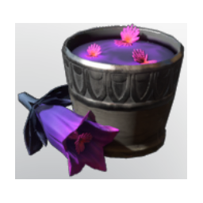

# Nightplant tea

| | |
|---|---|
| Category | [Consumables](../../categories/consumables.md) |
| Rarity | 🔵 Rare |
| Level | - |
| Max stack | 20 |
| Item ID | `664951543` |
| Internal name | `Food_T5_dish_nightplant_NightHerbTea` |

## Description

A strong, herbal tea. It increases your endurance and dexterity. The added gentian creates a smooth texture and extends your Time in the Shroud.

## Where to find

Kitchen

## Stats

| | |
|---|---|
| Damage against Fogger | 15 |
| Duration | 50:00 min |
| Fog Survivability Extension | 180,000 |

## How to get it

- **Kitchen**: 3 × [Night pink gentian](../../items/materials/night-pink-gentian-3548539501.md), 3 × [Shadow Rose](../../items/materials/shadow-rose-310580024.md) → 5 ×

---

[← Consumables](../../categories/consumables.md) · [All categories](../../README.md) · [JSON](nightplant-tea-664951543.json)
