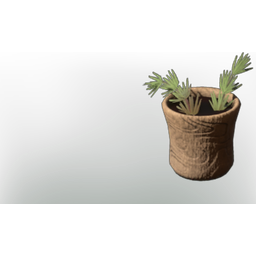

# Rooibos Tea

| | |
|---|---|
| Category | [Consumables](../../categories/consumables.md) |
| Rarity | 🟢 Uncommon |
| Level | - |
| Max stack | 20 |
| Item ID | `2982995291` |
| Internal name | `Food_T3_dish_hydration_RooibosTea` |

## Description

An aromatic that calms the body, providing an instant boost of energy for the user.

## Where to find

Kitchen

## Stats

| | |
|---|---|
| Duration | 40:00 min |
| Stamina | 30 |
| Stamina Regeneration | 18 |

## How to get it

- **Kitchen**: 5 × [Rooibos](../../items/materials/rooibos-1628543982.md) → 5 ×

---

[← Consumables](../../categories/consumables.md) · [All categories](../../README.md) · [JSON](rooibos-tea-2982995291.json)
