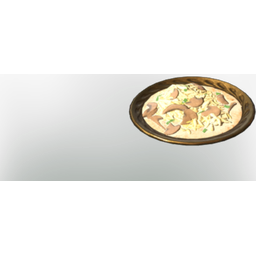

# Spaetzle with Mushroom Cream Sauce

| | |
|---|---|
| Category | [Consumables](../../categories/consumables.md) |
| Rarity | 🟢 Uncommon |
| Level | - |
| Max stack | 20 |
| Item ID | `1183822012` |
| Internal name | `Food_T5_dish_grain_SpaetzleMushroomCreamSauce` |

## Description

spatzle with mushroom cream sauce desc

## Where to find

Kitchen

## Stats

| | |
|---|---|
| Stamina | 20 |
| Melee Damage | 18 |
| Cold Resistance | 2 |
| Stamina Regeneration | 9 |
| Duration | 50:00 min |

## How to get it

- **Kitchen**: 2 × [Flour](../../items/materials/flour-169532188.md), 5 × [Eggs](../../items/consumables/eggs-1896276940.md), 3 × [Mountaingoat Milk](../../items/consumables/mountaingoat-milk-443792978.md), 5 × [Penny Bun](../../items/consumables/penny-bun-600862405.md) → 5 ×

---

[← Consumables](../../categories/consumables.md) · [All categories](../../README.md)
