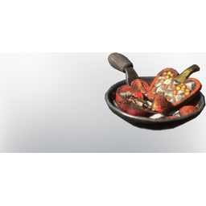

# Stir-Fried Vegetables

| | |
|---|---|
| Category | [Consumables](../../categories/consumables.md) |
| Rarity | 🔵 Rare |
| Level | - |
| Max stack | 20 |
| Item ID | `1105965780` |
| Internal name | `Food_T4_dish_vegetables_StirFriedVegetables` |

## Description

A healthy mix of vegetables. If handled with care, it won't only fill the stomach.

## Where to find

Kitchen

## Stats

| | |
|---|---|
| Duration | 45:00 min |
| Ranged Damage | 15 |
| % Dagger Damage | 15 |
| Stamina Regeneration | 12 |

## How to get it

- **Kitchen**: 5 × [Corncob](../../items/consumables/corncob-3118804138.md), 5 × [Forest Beet](../../items/consumables/forest-beet-3542827745.md), 5 × [Tomatos](../../items/consumables/tomatos-1036540037.md), 5 × [Bell Pepper](../../items/consumables/bell-pepper-4094316095.md), 3 × [Spice](../../items/materials/spice-1126086984.md) → 5 ×

---

[← Consumables](../../categories/consumables.md) · [All categories](../../README.md)
