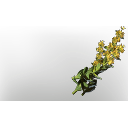

# T5 Food Raw Herb Gentian

| | |
|---|---|
| Category | [Consumables](../../categories/consumables.md) |
| Rarity | ⚪ Common |
| Level | - |
| Max stack | 100 |
| Item ID | `3779366146` |
| Internal name | `Food_T5_raw_herb_Gentian` |

## Description

t5 food raw herb Gentian desc. Adds spirit

## Where to find

Albaneve Summits

## Stats

| | |
|---|---|
| Mana | 100 |
| Duration | 20:00 min |

## Used to make

[Pumpkin Soup](../../items/consumables/pumpkin-soup-2905059781.md), [Mountain herbs tea](../../items/consumables/mountain-herbs-tea-3268443018.md), [Yellow Glow Soup](../../items/consumables/yellow-glow-soup-305385380.md), [T5 Health potion](../../items/consumables/t5-health-potion-2405125031.md), [Consumable Potion Mana T5](../../items/consumables/consumable-potion-mana-t5-3087876.md), [T5 Chain Heal II](../../items/ammunition/t5-chain-heal-ii-3216582163.md), [T5 gentian seedling](../../items/buildtools/t5-gentian-seedling-961655092.md)

---

[← Consumables](../../categories/consumables.md) · [All categories](../../README.md)
