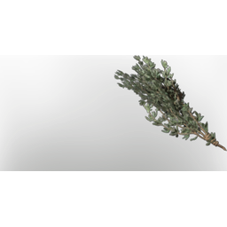

# Thyme

| | |
|---|---|
| Category | [Consumables](../../categories/consumables.md) |
| Rarity | ⚪ Common |
| Level | - |
| Max stack | 20 |
| Item ID | `3466985705` |
| Internal name | `Food_T7_raw_herb_Thyme` |

## Description

t7 herb thyme desc

## Where to find

Ancient Land

## Stats

| | |
|---|---|
| Duration | 30:00 min |
| Mana | 140 |

## Used to make

[T7 Bandage](../../items/consumables/t7-bandage-2105748910.md), [(honeyed) Thyme Tea](../../items/consumables/honeyed-thyme-tea-2818493303.md), [Cabbage Mushroom Rice](../../items/consumables/cabbage-mushroom-rice-2848753277.md), [Ancient Health Potion](../../items/consumables/ancient-health-potion-609216940.md), [T7 Eternal Chain Heal II](../../items/ammunition/t7-eternal-chain-heal-ii-1375984897.md), [Thyme Seedling](../../items/buildtools/thyme-seedling-3415410466.md)

---

[← Consumables](../../categories/consumables.md) · [All categories](../../README.md)
