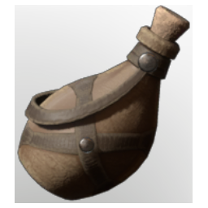

# Water Pouch

| | |
|---|---|
| Category | [Consumables](../../categories/consumables.md) |
| Rarity | ⚪ Common |
| Level | - |
| Max stack | 1 |
| Item ID | `3833797336` |
| Internal name | `Tool_Water_Pouch_Refillable` |

## Description

A sip of water helps to recharge your power!

## Where to find

refill at lakes and wells

## Stats

| | |
|---|---|
| Stamina | 5 |
| Stamina Regeneration | 10 |
| Duration | 15:00 min |

## How to get it

- **an unnamed station**: 1 × [Animal Fur](../../items/materials/animal-fur-984234407.md) → 1 ×

---

[← Consumables](../../categories/consumables.md) · [All categories](../../README.md) · [JSON](water-pouch-3833797336.json)
