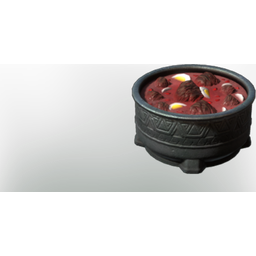

# Yak Stew

| | |
|---|---|
| Category | [Consumables](../../categories/consumables.md) |
| Rarity | 🟢 Uncommon |
| Level | - |
| Max stack | 20 |
| Item ID | `2634459448` |
| Internal name | `Food_T5_dish_meat_YakStew` |

## Description

A burning hot, meaty stew. Increases your resistance against extreme cold and improves your health and melee damage.

## Where to find

Kitchen

## Stats

| | |
|---|---|
| Duration | 50:00 min |
| Health Regeneration | 12 |
| Health | 240 |
| Cold Resistance | 2 |

## How to get it

- **Kitchen**: 2 × [Eggs](../../items/consumables/eggs-1896276940.md), 3 × [T5 Raw Fat Meat](../../items/consumables/t5-raw-fat-meat-2306767560.md), 4 × [Tomatos](../../items/consumables/tomatos-1036540037.md), 3 × [Mountaingoat Milk](../../items/consumables/mountaingoat-milk-443792978.md) → 5 ×

---

[← Consumables](../../categories/consumables.md) · [All categories](../../README.md)
