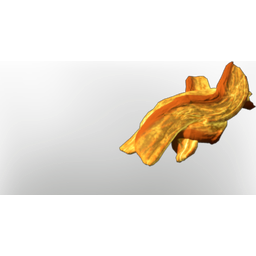

# Yellow Shroud Mushroom

| | |
|---|---|
| Category | [Consumables](../../categories/consumables.md) |
| Rarity | ⚪ Common |
| Level | - |
| Max stack | 20 |
| Item ID | `1683685602` |
| Internal name | `Food_T5_raw_bad_mushroom_YellowFogMushroom` |

## Description

Tastes very bitter. Maybe palatable  when cooked.

## Where to find

find in Albaneve Summits Shroud

## Stats

| | |
|---|---|
| Stamina | -60 |
| Health | -70 |

## Used to make

[Yellow Glow Soup](../../items/consumables/yellow-glow-soup-305385380.md), [Chanterelle Seedling](../../items/buildtools/chanterelle-seedling-1783208373.md)

---

[← Consumables](../../categories/consumables.md) · [All categories](../../README.md)
