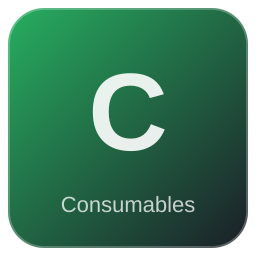

# Yucca Fruit

| | |
|---|---|
| Category | [Consumables](../../categories/consumables.md) |
| Rarity | ⚪ Common |
| Level | - |
| Max stack | 20 |
| Item ID | `2008478235` |
| Internal name | `Food_T4_raw_fruit_YuccaFruit` |

## Description

A sweet fruit that grows in dry areas, needing little water. Despite that, it's quite refreshing, especially for the body!

## Where to find

Kindlewastes

---

[← Consumables](../../categories/consumables.md) · [All categories](../../README.md)
