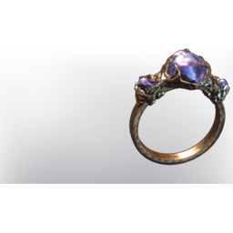

# Commander's Ring

| | |
|---|---|
| Category | [Armor & Equipment](../../categories/equipment.md) |
| Rarity | 🟣 Epic |
| Level | 15 |
| Max stack | 1 |
| Item ID | `1993216032` |
| Internal name | `Ring_T3_ministory_03` |

## Description

A simple and sturdy ring, decorated with 3 azure gemstones. It was found inside the maw of the creature that haunts the Citadel.

## Stats

| | |
|---|---|
| Slot | Ring |
| Health | 40 |
| Mana | 16 |
| Stamina | 8 |

## Enhancements

Unlocked one after another as the item is upgraded, in this order. Armor and damage bonuses grow with the item level, so their numbers are shown in game only.

| | Enhancement | Effect |
|:---:|---|---|
| 1 | +1 Bash | Increases the skill level of Bash by +1 |
| 2 | +1 Heavy Plates | Increases the skill level of Heavy Plates by +1 |
| 3 | Health Leech | +4 Health Leech |
| 4 | Health Leech | On Hit Leech 5% Damage as Health |

---

[← Armor & Equipment](../../categories/equipment.md) · [All categories](../../README.md) · [JSON](commander-s-ring-1993216032.json)
