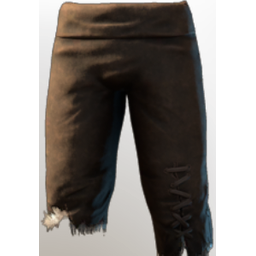

# Fur Trousers

| | |
|---|---|
| Category | [Armor & Equipment](../../categories/equipment.md) |
| Rarity | ⚪ Common |
| Level | 4 |
| Max stack | 1 |
| Item ID | `1081861051` |
| Internal name | `Armor_T0_Fur_Legs` |

## Description

A little archaic but better than cloth.

## Stats

| | |
|---|---|
| Slot | Legs |
| Armor | Physical and Magical |

## Enhancements

Unlocked one after another as the item is upgraded, in this order. Armor and damage bonuses grow with the item level, so their numbers are shown in game only.

| | Enhancement | Effect |
|:---:|---|---|
| 1 | Cutting Armor | - |
| 2 | Blunt Armor | - |
| 3 | +1 Steadfast | Increases the skill level of Steadfast by +1 |
| 4 | Health | +20 Health |
| 5 | +1 Thrust | Increases the skill level of Thrust by +1 |

## How to get it

- **Blacksmith**: 1 × [Torn Cloth](../../items/materials/torn-cloth-1496290527.md), 2 × [Animal Fur](../../items/materials/animal-fur-984234407.md), 2 × [String](../../items/materials/string-419344916.md), 1 × [Metal Scraps](../../items/materials/metal-scraps-132545371.md) → 1 ×

---

[← Armor & Equipment](../../categories/equipment.md) · [All categories](../../README.md) · [JSON](fur-trousers-1081861051.json)
