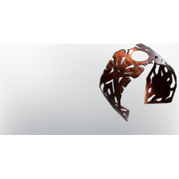

# Ghostly Shield

| | |
|---|---|
| Category | [Armor & Equipment](../../categories/equipment.md) |
| Rarity | 🔵 Rare |
| Level | 10 |
| Max stack | 1 |
| Item ID | `2331461341` |
| Internal name | `Ward_T2` |

One of 2 versions of this item: see [Ghostly Shield](../../objects/equipment/ghostly-shield.md) for all of them and how they differ.

## Description

ward t2 desc

## Stats

| | |
|---|---|
| Slot | Shield |
| Parry Power | 1 |
| Mana Regeneration | 3 |
| Fire Resistance | 5 |

## Enhancements

Unlocked one after another as the item is upgraded, in this order. Armor and damage bonuses grow with the item level, so their numbers are shown in game only.

| | Enhancement | Effect |
|:---:|---|---|
| 1 | +1 Eternal Spark | Increases the skill level of Eternal Spark by +1 |
| 2 | +1 Fire Resistance | Increases the skill level of Fire Resistance by +1 |
| 3 | +1 Arcane Deflection | Increases the skill level of Arcane Deflection by +1 |
| 4 | +1 Unity | Increases the skill level of Unity by +1 |
| 5 | +1 Wand Mastery | Increases the skill level of Wand Mastery by +1 |

## How to get it

- **Alchemist**: 4 × [Amber](../../items/materials/amber-1862351329.md), 2 × [Copper Bar](../../items/materials/copper-bar-170689373.md), 1 × [Giant Critter Scales](../../items/materials/giant-critter-scales-3571891401.md) → 1 ×

---

[← Armor & Equipment](../../categories/equipment.md) · [All categories](../../README.md) · [JSON](ghostly-shield-2331461341.json)
