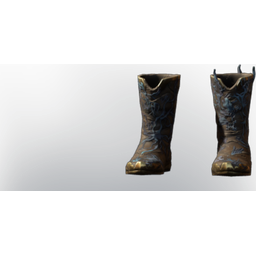

# Mage Fog Protection Armor

| | |
|---|---|
| Category | [Armor & Equipment](../../categories/equipment.md) |
| Rarity | 🔵 Rare |
| Level | 15 |
| Max stack | 1 |
| Item ID | `4045860943` |
| Internal name | `Armor_T3_Mage_FogProtection_Boots` |

One of 5 versions of this item: see [Mage Fog Protection Armor](../../objects/equipment/mage-fog-protection-armor.md) for all of them and how they differ.

## Description

Hastely put together from fell monster parts. Offers extended protection against the Shroud.

## Stats

| | |
|---|---|
| Slot | Feet |
| Armor | Physical and Magical |
| Mana Regeneration | 12 |
| Fog Resistance | 5 |

## Enhancements

Unlocked one after another as the item is upgraded, in this order. Armor and damage bonuses grow with the item level, so their numbers are shown in game only.

| | Enhancement | Effect |
|:---:|---|---|
| 1 | Cutting Armor | - |
| 2 | +1 Necromancer | Increases the skill level of Necromancer by +1 |
| 3 | +1 Necromancer | Increases the skill level of Necromancer by +1 |

## How to get it

- **Alchemist**: 15 × [Acidic Shroud](../../items/materials/acidic-shroud-409810488.md), 2 × [Indigo Plant](../../items/materials/indigo-plant-4276529065.md), 2 × [Tin Bars](../../items/materials/tin-bars-1072522988.md), 2 × [Leather](../../items/materials/leather-4135223598.md) → 1 ×

---

[← Armor & Equipment](../../categories/equipment.md) · [All categories](../../README.md) · [JSON](mage-fog-protection-armor-4045860943.json)
