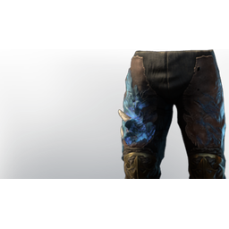

# Ranger Fog Protection Armor

| | |
|---|---|
| Category | [Armor & Equipment](../../categories/equipment.md) |
| Rarity | 🔵 Rare |
| Level | 15 |
| Max stack | 1 |
| Item ID | `1184502832` |
| Internal name | `Armor_T3_Ranger_FogProtection_Legs` |

One of 5 versions of this item: see [Ranger Fog Protection Armor](../../objects/equipment/ranger-fog-protection-armor.md) for all of them and how they differ.

## Description

Hastely put together from fell monster parts. Offers extended protection against the Shroud.

## Stats

| | |
|---|---|
| Slot | Legs |
| Armor | Physical and Magical |
| Stamina | 14 |
| Flame Power | 30,000 |

## Enhancements

Unlocked one after another as the item is upgraded, in this order. Armor and damage bonuses grow with the item level, so their numbers are shown in game only.

| | Enhancement | Effect |
|:---:|---|---|
| 1 | Blunt Armor | - |
| 2 | +1 Blessed Arrows | Increases the skill level of Blessed Arrows by +1 |
| 3 | +1 Swiftshot Sustenance | Increases the skill level of Swiftshot Sustenance by +1 |

## How to get it

- **Hunter**: 2 × [Rooibos](../../items/materials/rooibos-1628543982.md), 2 × [Feather](../../items/materials/feather-3838906683.md), 3 × [Leather](../../items/materials/leather-4135223598.md), 2 × [Bronze Bars](../../items/materials/bronze-bars-642002617.md), 5 × [Linnen](../../items/materials/linnen-1815424180.md) → 1 ×

---

[← Armor & Equipment](../../categories/equipment.md) · [All categories](../../README.md) · [JSON](ranger-fog-protection-armor-1184502832.json)
