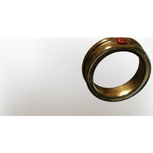

# Ring of Health

| | |
|---|---|
| Category | [Armor & Equipment](../../categories/equipment.md) |
| Rarity | 🟢 Uncommon |
| Level | 10 |
| Max stack | 1 |
| Item ID | `4070275753` |
| Internal name | `Ring_T2_Ring_of_Health` |

## Description

this ring will increase your Health and Healing rate.

## Stats

| | |
|---|---|
| Slot | Ring |
| Health | 25 |
| Health Regeneration | 5 |

## Enhancements

Unlocked one after another as the item is upgraded, in this order. Armor and damage bonuses grow with the item level, so their numbers are shown in game only.

| | Enhancement | Effect |
|:---:|---|---|
| 1 | Health | +40 Health |
| 2 | Vital | +6 Vital |
| 3 | +1 Veteran | Increases the skill level of Veteran by +1 |
| 4 | Health Leech | +3 Health Leech |
| 5 | +1 Battle Heal | Increases the skill level of Battle Heal by +1 |

---

[← Armor & Equipment](../../categories/equipment.md) · [All categories](../../README.md)
