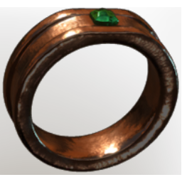

# Ring of Stamina

| | |
|---|---|
| Category | [Armor & Equipment](../../categories/equipment.md) |
| Rarity | 🟢 Uncommon |
| Level | 10 |
| Max stack | 1 |
| Item ID | `857219651` |
| Internal name | `Ring_T2_Ring_of_Stamina` |

## Description

This  ancient ring will  give you stamina and increase your recovery.

## Stats

| | |
|---|---|
| Slot | Ring |
| Stamina | 5 |
| Stamina Regeneration | 5 |

## Enhancements

Unlocked one after another as the item is upgraded, in this order. Armor and damage bonuses grow with the item level, so their numbers are shown in game only.

| | Enhancement | Effect |
|:---:|---|---|
| 1 | Stamina | +8 Stamina |
| 2 | Enduring | +6 Enduring |
| 3 | +1 Sniper | Increases the skill level of Sniper by +1 |
| 4 | Stamina Leech | +2 Stamina Leech |
| 5 | +1 Fatal Precision | Increases the skill level of Fatal Precision by +1 |

---

[← Armor & Equipment](../../categories/equipment.md) · [All categories](../../README.md)
