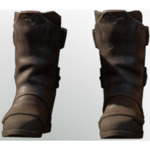

# Rising Fighter Boots

| | |
|---|---|
| Category | [Armor & Equipment](../../categories/equipment.md) |
| Rarity | 🟢 Uncommon |
| Level | 5 |
| Max stack | 1 |
| Item ID | `1694671169` |
| Internal name | `Armor_T1_Warrior_DPS_Boots` |

One of 2 versions of this item: see [Rising Fighter Boots](../../objects/equipment/rising-fighter-boots.md) for all of them and how they differ.

## Description

Footwork is the most important basic of swordsmanship. These boots should prepare you for your later and make learning the first steps easier.

## Stats

| | |
|---|---|
| Slot | Feet |
| Armor | Physical and Magical |
| Health Regeneration | 3 |

## Enhancements

Unlocked one after another as the item is upgraded, in this order. Armor and damage bonuses grow with the item level, so their numbers are shown in game only.

| | Enhancement | Effect |
|:---:|---|---|
| 1 | Blunt Armor | - |
| 2 | Piercing Armor | - |
| 3 | +1 Warrior's Path | Increases the skill level of Warrior's Path by +1 |
| 4 | Vital | +3 Vital |
| 5 | +1 Warrior's Path | Increases the skill level of Warrior's Path by +1 |

## How to get it

- **Blacksmith**: 2 × [Animal Fur](../../items/materials/animal-fur-984234407.md), 5 × [Resin](../../items/materials/resin-4109728689.md), 1 × [Metal Sheets](../../items/materials/metal-sheets-4271896226.md), 15 × [Mycelium](../../items/materials/mycelium-3509012331.md) → 1 ×

---

[← Armor & Equipment](../../categories/equipment.md) · [All categories](../../README.md)
