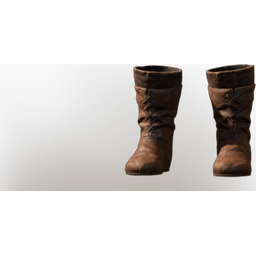

# Scout Boots

| | |
|---|---|
| Category | [Armor & Equipment](../../categories/equipment.md) |
| Rarity | 🟢 Uncommon |
| Level | 5 |
| Max stack | 1 |
| Item ID | `1677017695` |
| Internal name | `Armor_T1_Ranger_Archer_DPS_Boots_Loot` |

One of 2 versions of this item: see [Scout Boots](../../objects/equipment/scout-boots.md) for all of them and how they differ.

## Description

On quiet soles the path of the scout is a little easier.

## Stats

| | |
|---|---|
| Slot | Feet |
| Armor | Physical and Magical |
| Stamina Regeneration | 3 |

## Enhancements

Unlocked one after another as the item is upgraded, in this order. Armor and damage bonuses grow with the item level, so their numbers are shown in game only.

| | Enhancement | Effect |
|:---:|---|---|
| 1 | Cutting Armor | - |
| 2 | Piercing Armor | - |
| 3 | +1 Runner | Increases the skill level of Runner by +1 |
| 4 | Enduring | +3 Enduring |
| 5 | +1 Runner | Increases the skill level of Runner by +1 |

---

[← Armor & Equipment](../../categories/equipment.md) · [All categories](../../README.md) · [JSON](scout-boots-1677017695.json)
