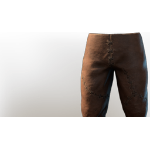

# Scout Pants

| | |
|---|---|
| Category | [Armor & Equipment](../../categories/equipment.md) |
| Rarity | 🟢 Uncommon |
| Level | 5 |
| Max stack | 1 |
| Item ID | `2519499294` |
| Internal name | `Armor_T1_Ranger_Archer_DPS_Legs_Loot` |

One of 2 versions of this item: see [Scout Pants](../../objects/equipment/scout-pants.md) for all of them and how they differ.

## Description

Silent pants to tread quietly.

## Stats

| | |
|---|---|
| Slot | Legs |
| Armor | Physical and Magical |
| Stamina | 5 |

## Enhancements

Unlocked one after another as the item is upgraded, in this order. Armor and damage bonuses grow with the item level, so their numbers are shown in game only.

| | Enhancement | Effect |
|:---:|---|---|
| 1 | Blunt Armor | - |
| 2 | Blunt Armor | - |
| 3 | +1 Blessed Arrows | Increases the skill level of Blessed Arrows by +1 |
| 4 | Stamina | +4 Stamina |
| 5 | +1 Swiftshot Sustenance | Increases the skill level of Swiftshot Sustenance by +1 |

---

[← Armor & Equipment](../../categories/equipment.md) · [All categories](../../README.md) · [JSON](scout-pants-2519499294.json)
