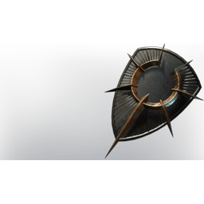

# Shield of Light

| | |
|---|---|
| Category | [Armor & Equipment](../../categories/equipment.md) |
| Rarity | 🔵 Rare |
| Level | 20 |
| Max stack | 1 |
| Item ID | `2584194594` |
| Internal name | `Shield_T4_Tank` |

One of 2 versions of this item: see [Shield of Light](../../objects/equipment/shield-of-light.md) for all of them and how they differ.

## Description

This sacred shield consecrated by the Flame allows you to **block** physical attacks. Blocking drains Stamina.
Flame Power allows you to stay in the Fog longer.

---

[← Armor & Equipment](../../categories/equipment.md) · [All categories](../../README.md)
