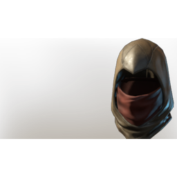

# T2 Archer Helmet

| | |
|---|---|
| Category | [Armor & Equipment](../../categories/equipment.md) |
| Rarity | 🔵 Rare |
| Level | 10 |
| Max stack | 1 |
| Item ID | `3351665828` |
| Internal name | `Armor_T2_Ranger_Assassin_Helmet` |

One of 2 versions of this item: see [T2 Archer Helmet](../../objects/equipment/t2-archer-helmet.md) for all of them and how they differ.

## Description

A darkened hood which lets you blend into the woodland scenery more easily.

## Stats

| | |
|---|---|
| Slot | Head |
| Armor | Physical and Magical |
| Backstab Damage | 13 |

## Enhancements

Unlocked one after another as the item is upgraded, in this order. Armor and damage bonuses grow with the item level, so their numbers are shown in game only.

| | Enhancement | Effect |
|:---:|---|---|
| 1 | Piercing Armor | - |
| 2 | Enduring | +6 Enduring |
| 3 | +1 Backstab Mastery | Increases the skill level of Backstab Mastery by +1 |
| 4 | Ice Armor | - |
| 5 | +1 Backstab Mastery | Increases the skill level of Backstab Mastery by +1 |

## How to get it

- **Hunter**: 4 × [Indigo Plant](../../items/materials/indigo-plant-4276529065.md), 1 × [Bug Dust](../../items/materials/bug-dust-957162158.md), 1 × [Dried Fur](../../items/materials/dried-fur-3420500473.md), 5 × [Shroud Mush](../../items/materials/shroud-mush-4229884102.md) → 1 ×

---

[← Armor & Equipment](../../categories/equipment.md) · [All categories](../../README.md)
