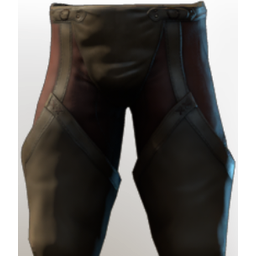

# T2 Archer Legs

| | |
|---|---|
| Category | [Armor & Equipment](../../categories/equipment.md) |
| Rarity | 🔵 Rare |
| Level | 10 |
| Max stack | 1 |
| Item ID | `3559413170` |
| Internal name | `Armor_T2_Ranger_Assassin_Legs` |

One of 2 versions of this item: see [T2 Archer Legs](../../objects/equipment/t2-archer-legs.md) for all of them and how they differ.

## Description

The added leather grants superior protection from jagged rocks, unruly tree bark and counter arrows.

## Stats

| | |
|---|---|
| Slot | Legs |
| Armor | Physical and Magical |
| Sneak  Speed | 30 |

## Enhancements

Unlocked one after another as the item is upgraded, in this order. Armor and damage bonuses grow with the item level, so their numbers are shown in game only.

| | Enhancement | Effect |
|:---:|---|---|
| 1 | Blunt Armor | - |
| 2 | Stamina | +8 Stamina |
| 3 | +1 Cutthroat | Increases the skill level of Cutthroat by +1 |
| 4 | Shock Armor | - |
| 5 | +1 Veiled Vigor | Increases the skill level of Veiled Vigor |

## How to get it

- **Hunter**: 2 × [Linnen](../../items/materials/linnen-1815424180.md), 1 × [Reptile Leather](../../items/materials/reptile-leather-291752398.md), 4 × [Bones](../../items/materials/bones-2053375978.md), 2 × [Goo](../../items/materials/goo-3403995938.md), 2 × [Corrupted Boar Tusk](../../items/materials/corrupted-boar-tusk-3405461465.md) → 1 ×

---

[← Armor & Equipment](../../categories/equipment.md) · [All categories](../../README.md) · [JSON](t2-archer-legs-3559413170.json)
