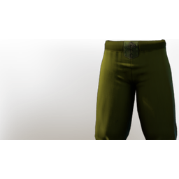

# T2 Healer Legs

| | |
|---|---|
| Category | [Armor & Equipment](../../categories/equipment.md) |
| Rarity | 🔵 Rare |
| Level | 10 |
| Max stack | 1 |
| Item ID | `722422442` |
| Internal name | `Armor_T2_Mage_Healer_Legs` |

One of 2 versions of this item: see [T2 Healer Legs](../../objects/equipment/t2-healer-legs.md) for all of them and how they differ.

## Description

Woven pants which keep the wearer from scraping their knees.

## Stats

| | |
|---|---|
| Slot | Legs |
| Armor | Physical and Magical |
| Revive Duration | 0.007 s |

## Enhancements

Unlocked one after another as the item is upgraded, in this order. Armor and damage bonuses grow with the item level, so their numbers are shown in game only.

| | Enhancement | Effect |
|:---:|---|---|
| 1 | Piercing Armor | - |
| 2 | Piercing Armor | - |
| 3 | +1 Healing Revive | Increases the skill level of Healing Revive by +1 |
| 4 | Health | +40 Health |
| 5 | +1 Healing Revive | Increases the skill level of Healing Revive by +1 |

## How to get it

- **Alchemist**: 4 × [Charcoal](../../items/materials/charcoal-372029138.md), 4 × [Torn Cloth](../../items/materials/torn-cloth-1496290527.md), 1 × [Bug Dust](../../items/materials/bug-dust-957162158.md), 1 × [Copper Bar](../../items/materials/copper-bar-170689373.md), 2 × [Corrupted Boar Tusk](../../items/materials/corrupted-boar-tusk-3405461465.md) → 1 ×

---

[← Armor & Equipment](../../categories/equipment.md) · [All categories](../../README.md) · [JSON](t2-healer-legs-722422442.json)
