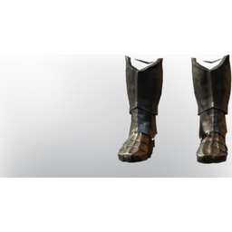

# T2 Lore Armor Fogger Boots

| | |
|---|---|
| Category | [Armor & Equipment](../../categories/equipment.md) |
| Rarity | 🔵 Rare |
| Level | 10 |
| Max stack | 1 |
| Item ID | `1225142754` |
| Internal name | `Armor_T2_MultiClass_FogPowered_Boots_ministory_13` |

## Description

Boots of an elixir infused armor set

## Stats

| | |
|---|---|
| Slot | Feet |
| Armor | Physical and Magical |
| Health Regeneration | 3 |
| Stamina Regeneration | 3 |
| Max Shroud Survivability | -60,000 |

## Enhancements

Unlocked one after another as the item is upgraded, in this order. Armor and damage bonuses grow with the item level, so their numbers are shown in game only.

| | Enhancement | Effect |
|:---:|---|---|
| 1 | +1 Warrior's Path | Increases the skill level of Warrior's Path by +1 |
| 2 | +1 Iceman | Increases the skill level of Iceman by +1 |
| 3 | +1 Eagle's Bane | Increases the skill level of Eagle's Bane by +1 |

---

[← Armor & Equipment](../../categories/equipment.md) · [All categories](../../README.md) · [JSON](t2-lore-armor-fogger-boots-1225142754.json)
