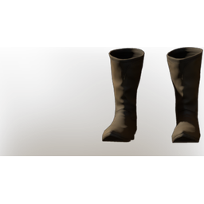

# T2 Mage Boots

| | |
|---|---|
| Category | [Armor & Equipment](../../categories/equipment.md) |
| Rarity | 🔵 Rare |
| Level | 10 |
| Max stack | 1 |
| Item ID | `2841320705` |
| Internal name | `Armor_T2_Mage_Wizard_DPS_Boots` |

One of 2 versions of this item: see [T2 Mage Boots](../../objects/equipment/t2-mage-boots.md) for all of them and how they differ.

## Description

Light and fashionable.

## Stats

| | |
|---|---|
| Slot | Feet |
| Armor | Physical and Magical |
| Mana Regeneration | 8 |

## Enhancements

Unlocked one after another as the item is upgraded, in this order. Armor and damage bonuses grow with the item level, so their numbers are shown in game only.

| | Enhancement | Effect |
|:---:|---|---|
| 1 | Cutting Armor | - |
| 2 | Blunt Armor | - |
| 3 | +1 Necromancer | Increases the skill level of Necromancer by +1 |
| 4 | Spiritual | +8 Spiritual |
| 5 | +1 Iceman | Increases the skill level of Iceman by +1 |

## How to get it

- **Alchemist**: 1 × [Bug Dust](../../items/materials/bug-dust-957162158.md), 2 × [Resin](../../items/materials/resin-4109728689.md), 1 × [Reptile Leather](../../items/materials/reptile-leather-291752398.md), 2 × [Brittle Shroud Petals](../../items/materials/brittle-shroud-petals-1284326318.md) → 1 ×

---

[← Armor & Equipment](../../categories/equipment.md) · [All categories](../../README.md)
