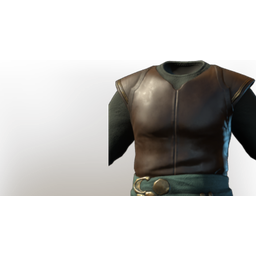

# T2 Ranger Chest

| | |
|---|---|
| Category | [Armor & Equipment](../../categories/equipment.md) |
| Rarity | 🔵 Rare |
| Level | 10 |
| Max stack | 1 |
| Item ID | `1856277122` |
| Internal name | `Armor_T2_Ranger_Archer_DPS_Chest` |

One of 2 versions of this item: see [T2 Ranger Chest](../../objects/equipment/t2-ranger-chest.md) for all of them and how they differ.

## Description

Minor protection, but it hardly matters. Just hit them before they ever see you.

## Stats

| | |
|---|---|
| Slot | Chest |
| Armor | Physical and Magical |
| Stamina | 24 |

## Enhancements

Unlocked one after another as the item is upgraded, in this order. Armor and damage bonuses grow with the item level, so their numbers are shown in game only.

| | Enhancement | Effect |
|:---:|---|---|
| 1 | Blunt Armor | - |
| 2 | Piercing Armor | - |
| 3 | +1 Vitality Surge | Increases the skill level of Vitality Surge by +1 |
| 4 | Stamina | +8 Stamina |
| 5 | +1 Ranger | Increases the skill level of Ranger by +1 |

## How to get it

- **Hunter**: 1 × [Linnen](../../items/materials/linnen-1815424180.md), 1 × [Reptile Leather](../../items/materials/reptile-leather-291752398.md), 4 × [Copper Bar](../../items/materials/copper-bar-170689373.md), 4 × [Amber](../../items/materials/amber-1862351329.md), 3 × [Giant Critter Scales](../../items/materials/giant-critter-scales-3571891401.md) → 1 ×

---

[← Armor & Equipment](../../categories/equipment.md) · [All categories](../../README.md) · [JSON](t2-ranger-chest-1856277122.json)
