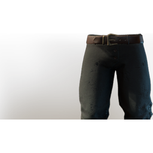

# T2 Ranger Legs

| | |
|---|---|
| Category | [Armor & Equipment](../../categories/equipment.md) |
| Rarity | 🔵 Rare |
| Level | 10 |
| Max stack | 1 |
| Item ID | `2374868988` |
| Internal name | `Armor_T2_Ranger_Archer_DPS_Legs` |

One of 2 versions of this item: see [T2 Ranger Legs](../../objects/equipment/t2-ranger-legs.md) for all of them and how they differ.

## Description

Pants which protect your legs from brambles and thorns when hunting.

## Stats

| | |
|---|---|
| Slot | Legs |
| Armor | Physical and Magical |
| Stamina | 9 |

## Enhancements

Unlocked one after another as the item is upgraded, in this order. Armor and damage bonuses grow with the item level, so their numbers are shown in game only.

| | Enhancement | Effect |
|:---:|---|---|
| 1 | Blunt Armor | - |
| 2 | Blunt Armor | - |
| 3 | +1 Blessed Arrows | Increases the skill level of Blessed Arrows by +1 |
| 4 | Stamina | +8 Stamina |
| 5 | +1 Swiftshot Sustenance | Increases the skill level of Swiftshot Sustenance by +1 |

## How to get it

- **Hunter**: 1 × [Linnen](../../items/materials/linnen-1815424180.md), 4 × [Torn Cloth](../../items/materials/torn-cloth-1496290527.md), 1 × [Reptile Leather](../../items/materials/reptile-leather-291752398.md), 2 × [Resin](../../items/materials/resin-4109728689.md), 2 × [Corrupted Boar Tusk](../../items/materials/corrupted-boar-tusk-3405461465.md) → 1 ×

---

[← Armor & Equipment](../../categories/equipment.md) · [All categories](../../README.md) · [JSON](t2-ranger-legs-2374868988.json)
