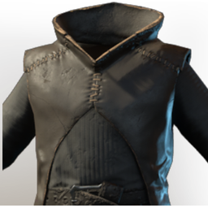

# T2 Wizard Chest

| | |
|---|---|
| Category | [Armor & Equipment](../../categories/equipment.md) |
| Rarity | 🔵 Rare |
| Level | 10 |
| Max stack | 1 |
| Item ID | `2675141124` |
| Internal name | `Armor_T2_Mage_BattleWand_Chest_Loot` |

## Description

Protects the wearer from stray sparks and sudden cold flashes.

## Stats

| | |
|---|---|
| Slot | Chest |
| Armor | Physical and Magical |
| Wand Damage | 3 |

## Enhancements

Unlocked one after another as the item is upgraded, in this order. Armor and damage bonuses grow with the item level, so their numbers are shown in game only.

| | Enhancement | Effect |
|:---:|---|---|
| 1 | Cutting Armor | - |
| 2 | Fog Armor | - |
| 3 | +1 Life Essences | Increases the skill level of Life Essences by +1 |
| 4 | Health | +40 Health |
| 5 | +1 Wizard | Increases the skill level of Wizard by +1 |

---

[← Armor & Equipment](../../categories/equipment.md) · [All categories](../../README.md) · [JSON](t2-wizard-chest-2675141124.json)
