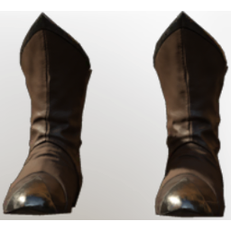

# T3 Archer Boots

| | |
|---|---|
| Category | [Armor & Equipment](../../categories/equipment.md) |
| Rarity | 🔵 Rare |
| Level | 15 |
| Max stack | 1 |
| Item ID | `905258707` |
| Internal name | `Armor_T3_Ranger_Assassin_Boots` |

One of 2 versions of this item: see [T3 Archer Boots](../../objects/equipment/t3-archer-boots.md) for all of them and how they differ.

## Description

With these metal weighted soles, even shaky or uneven ground will not disturb your aim.

## Stats

| | |
|---|---|
| Slot | Feet |
| Armor | Physical and Magical |
| Mana Regeneration | 6 |
| Stamina Regeneration | 9 |

## Enhancements

Unlocked one after another as the item is upgraded, in this order. Armor and damage bonuses grow with the item level, so their numbers are shown in game only.

| | Enhancement | Effect |
|:---:|---|---|
| 1 | Cutting Armor | - |
| 2 | Vital | +9 Vital |
| 3 | +1 Thrust | Increases the skill level of Thrust by +1 |
| 4 | Fire Armor | - |
| 5 | +1 Thrust | Increases the skill level of Thrust by +1 |

## How to get it

- **Hunter**: 15 × [Acidic Shroud](../../items/materials/acidic-shroud-409810488.md), 2 × [Fossilized Bone](../../items/materials/fossilized-bone-3095665634.md), 1 × [Tin Bars](../../items/materials/tin-bars-1072522988.md), 3 × [Leather](../../items/materials/leather-4135223598.md) → 1 ×

---

[← Armor & Equipment](../../categories/equipment.md) · [All categories](../../README.md) · [JSON](t3-archer-boots-905258707.json)
