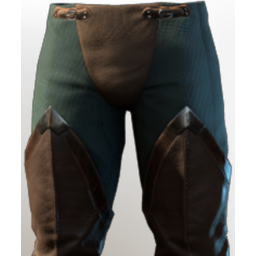

# T3 Archer Legs

| | |
|---|---|
| Category | [Armor & Equipment](../../categories/equipment.md) |
| Rarity | 🔵 Rare |
| Level | 15 |
| Max stack | 1 |
| Item ID | `3281783103` |
| Internal name | `Armor_T3_Ranger_Assassin_Legs` |

One of 2 versions of this item: see [T3 Archer Legs](../../objects/equipment/t3-archer-legs.md) for all of them and how they differ.

## Description

The pants were made from a set of different materials and protect all the most important areas adequately.

## Stats

| | |
|---|---|
| Slot | Legs |
| Armor | Physical and Magical |
| Mana | 27 |
| Sneak  Speed | 30 |

## Enhancements

Unlocked one after another as the item is upgraded, in this order. Armor and damage bonuses grow with the item level, so their numbers are shown in game only.

| | Enhancement | Effect |
|:---:|---|---|
| 1 | Blunt Armor | - |
| 2 | Stamina | +12 Stamina |
| 3 | +1 Cutthroat | Increases the skill level of Cutthroat by +1 |
| 4 | Shock Armor | - |
| 5 | +1 Veiled Vigor | Increases the skill level of Veiled Vigor |

## How to get it

- **Hunter**: 3 × [Shroud Adhesive](../../items/materials/shroud-adhesive-1047122195.md), 10 × [Green Mushroom Meat](../../items/materials/green-mushroom-meat-90588998.md), 2 × [Bronze Bars](../../items/materials/bronze-bars-642002617.md), 1 × [Petrified Fell Shell](../../items/materials/petrified-fell-shell-3594337385.md), 2 × [Feather](../../items/materials/feather-3838906683.md) → 1 ×

---

[← Armor & Equipment](../../categories/equipment.md) · [All categories](../../README.md) · [JSON](t3-archer-legs-3281783103.json)
