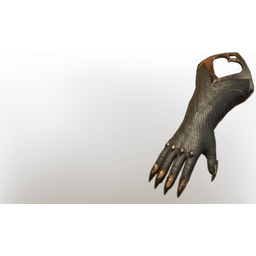

# T3 Mage Arms

| | |
|---|---|
| Category | [Armor & Equipment](../../categories/equipment.md) |
| Rarity | 🔵 Rare |
| Level | 15 |
| Max stack | 1 |
| Item ID | `536768042` |
| Internal name | `Armor_T3_Mage_Wizard_DPS_Arms_Loot` |

One of 2 versions of this item: see [T3 Mage Arms](../../objects/equipment/t3-mage-arms.md) for all of them and how they differ.

## Description

A magician's gloves, bound by magic infused golden thread.

## Stats

| | |
|---|---|
| Slot | Hands |
| Armor | Physical and Magical |
| Staff Damage | 9 |
| Damage against Magical Foes | 7 |

## Enhancements

Unlocked one after another as the item is upgraded, in this order. Armor and damage bonuses grow with the item level, so their numbers are shown in game only.

| | Enhancement | Effect |
|:---:|---|---|
| 1 | Blunt Armor | - |
| 2 | Cutting Armor | - |
| 3 | +1 Quick Charge | Increases the skill level of Quick Charge by +1 |
| 4 | Mana | +20 Mana |
| 5 | +1 Arsonist | Increases the skill level of Arsonist by +1 |

---

[← Armor & Equipment](../../categories/equipment.md) · [All categories](../../README.md) · [JSON](t3-mage-arms-536768042.json)
