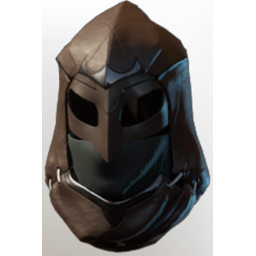

# T3 Ranger Helmet

| | |
|---|---|
| Category | [Armor & Equipment](../../categories/equipment.md) |
| Rarity | 🔵 Rare |
| Level | 15 |
| Max stack | 1 |
| Item ID | `1025627126` |
| Internal name | `Armor_T3_Ranger_Archer_DPS_Helmet_Loot` |

One of 2 versions of this item: see [T3 Ranger Helmet](../../objects/equipment/t3-ranger-helmet.md) for all of them and how they differ.

## Description

Remain unseen and strike from the shadows with this formidable archer's hood.

## Stats

| | |
|---|---|
| Slot | Head |
| Armor | Physical and Magical |
| Critical Strike Chance Ranged | 10 |
| Critical Strike Damage | 11 |

## Enhancements

Unlocked one after another as the item is upgraded, in this order. Armor and damage bonuses grow with the item level, so their numbers are shown in game only.

| | Enhancement | Effect |
|:---:|---|---|
| 1 | Piercing Armor | - |
| 2 | Cutting Armor | - |
| 3 | +1 Puncture | Increases the skill level of Puncture by +1 |
| 4 | Enduring | +9 Enduring |
| 5 | +1 Fatal Precision | Increases the skill level of Fatal Precision by +1 |

---

[← Armor & Equipment](../../categories/equipment.md) · [All categories](../../README.md) · [JSON](t3-ranger-helmet-1025627126.json)
