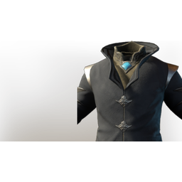

# T3 Wizard Chest

| | |
|---|---|
| Category | [Armor & Equipment](../../categories/equipment.md) |
| Rarity | 🔵 Rare |
| Level | 15 |
| Max stack | 1 |
| Item ID | `3029242112` |
| Internal name | `Armor_T3_Mage_BattleWand_Chest_Loot` |

## Description

An exquisite mystical coat made of fine, dyed material. The metal clasps alone are highly valuable.

## Stats

| | |
|---|---|
| Slot | Chest |
| Armor | Physical and Magical |
| Health | 180 |
| Wand Damage | 4 |

## Enhancements

Unlocked one after another as the item is upgraded, in this order. Armor and damage bonuses grow with the item level, so their numbers are shown in game only.

| | Enhancement | Effect |
|:---:|---|---|
| 1 | Cutting Armor | - |
| 2 | Fog Armor | - |
| 3 | +1 Life Essences | Increases the skill level of Life Essences by +1 |
| 4 | Health | +60 Health |
| 5 | +1 Wizard | Increases the skill level of Wizard by +1 |

---

[← Armor & Equipment](../../categories/equipment.md) · [All categories](../../README.md) · [JSON](t3-wizard-chest-3029242112.json)
