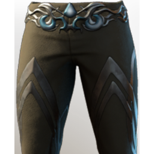

# T3 Wizard Legs

| | |
|---|---|
| Category | [Armor & Equipment](../../categories/equipment.md) |
| Rarity | 🔵 Rare |
| Level | 15 |
| Max stack | 1 |
| Item ID | `454495308` |
| Internal name | `Armor_T3_Mage_BattleWand_Legs_Loot` |

## Description

A pair of proper trousers. The metal accents around the waist are delicate and resemble the moon and the tide.

## Stats

| | |
|---|---|
| Slot | Legs |
| Armor | Physical and Magical |
| Health | 33 |
| Mana Regeneration | 12 |

## Enhancements

Unlocked one after another as the item is upgraded, in this order. Armor and damage bonuses grow with the item level, so their numbers are shown in game only.

| | Enhancement | Effect |
|:---:|---|---|
| 1 | Piercing Armor | - |
| 2 | Piercing Armor | - |
| 3 | +1 Eternal Spark | Increases the skill level of Eternal Spark by +1 |
| 4 | Health | +60 Health |
| 5 | +1 Unity | Increases the skill level of Unity by +1 |

---

[← Armor & Equipment](../../categories/equipment.md) · [All categories](../../README.md) · [JSON](t3-wizard-legs-454495308.json)
