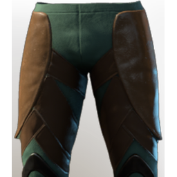

# T4 Archer Legs (hawk)

| | |
|---|---|
| Category | [Armor & Equipment](../../categories/equipment.md) |
| Rarity | 🔵 Rare |
| Level | 20 |
| Max stack | 1 |
| Item ID | `1960005749` |
| Internal name | `Armor_T4_Ranger_Adventurer_Legs_Loot` |

## Description

Pants such as these were originally made fashionable by a prominent hawker named Ferlin.

## Stats

| | |
|---|---|
| Slot | Legs |
| Armor | Physical and Magical |
| Stamina Depletion Sprinting | -20 |
| Stamina | 9 |
| Stamina Regeneration | 3 |

## Enhancements

Unlocked one after another as the item is upgraded, in this order. Armor and damage bonuses grow with the item level, so their numbers are shown in game only.

| | Enhancement | Effect |
|:---:|---|---|
| 1 | Blunt Armor | - |
| 2 | +1 Well Rested | Increases the skill level of Well Rested by +1 |
| 3 | +1 Cutthroat | Increases the skill level of Cutthroat by +1 |
| 4 | Stamina | +16 Stamina |
| 5 | +1 Veiled Vigor | Increases the skill level of Veiled Vigor |

---

[← Armor & Equipment](../../categories/equipment.md) · [All categories](../../README.md)
