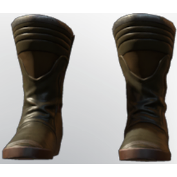

# T4 Assassin Boots

| | |
|---|---|
| Category | [Armor & Equipment](../../categories/equipment.md) |
| Rarity | 🔵 Rare |
| Level | 20 |
| Max stack | 1 |
| Item ID | `4024884903` |
| Internal name | `Armor_T4_Ranger_Assassin_Boots` |

One of 2 versions of this item: see [T4 Assassin Boots](../../objects/equipment/t4-assassin-boots.md) for all of them and how they differ.

## Description

Your steps will be quick and quiet with these supreme assassin boots.

## Stats

| | |
|---|---|
| Slot | Feet |
| Armor | Physical and Magical |
| Mana Regeneration | 8 |
| Stamina Regeneration | 12 |

## Enhancements

Unlocked one after another as the item is upgraded, in this order. Armor and damage bonuses grow with the item level, so their numbers are shown in game only.

| | Enhancement | Effect |
|:---:|---|---|
| 1 | Cutting Armor | - |
| 2 | Piercing Armor | - |
| 3 | +1 Thrust | Increases the skill level of Thrust by +1 |
| 4 | Vital | +12 Vital |
| 5 | +1 Thrust | Increases the skill level of Thrust by +1 |

## How to get it

- **Hunter**: 1 × [Leather](../../items/materials/leather-4135223598.md), 1 × [Iron Bars](../../items/materials/iron-bars-159114158.md), 4 × [Fossilized Bone Dust](../../items/materials/fossilized-bone-dust-3073226096.md), 20 × [Shroud Sand](../../items/materials/shroud-sand-1172450293.md) → 1 ×

---

[← Armor & Equipment](../../categories/equipment.md) · [All categories](../../README.md) · [JSON](t4-assassin-boots-4024884903.json)
