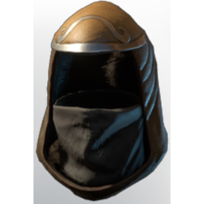

# T4 Assassin Helmet

| | |
|---|---|
| Category | [Armor & Equipment](../../categories/equipment.md) |
| Rarity | 🔵 Rare |
| Level | 20 |
| Max stack | 1 |
| Item ID | `1123774086` |
| Internal name | `Armor_T4_Ranger_Assassin_Helmet` |

One of 2 versions of this item: see [T4 Assassin Helmet](../../objects/equipment/t4-assassin-helmet.md) for all of them and how they differ.

## Description

A special piece of cloth was added to this assassin hood to hide the wearer's face, and their most likely daunting smile.

## Stats

| | |
|---|---|
| Slot | Head |
| Armor | Physical and Magical |
| Critical Melee Strike Chance | 11 |
| Backstab Damage | 19 |

## Enhancements

Unlocked one after another as the item is upgraded, in this order. Armor and damage bonuses grow with the item level, so their numbers are shown in game only.

| | Enhancement | Effect |
|:---:|---|---|
| 1 | Piercing Armor | - |
| 2 | Cutting Armor | - |
| 3 | +1 Backstab Mastery | Increases the skill level of Backstab Mastery by +1 |
| 4 | Enduring | +12 Enduring |
| 5 | +1 Backstab Mastery | Increases the skill level of Backstab Mastery by +1 |

## How to get it

- **Hunter**: 1 × [Leather](../../items/materials/leather-4135223598.md), 8 × [Lapislazuli](../../items/materials/lapislazuli-3044860358.md), 2 × [Fabric](../../items/materials/fabric-2128518559.md), 1 × [Fell Mist](../../items/materials/fell-mist-2698923038.md) → 1 ×

---

[← Armor & Equipment](../../categories/equipment.md) · [All categories](../../README.md) · [JSON](t4-assassin-helmet-1123774086.json)
