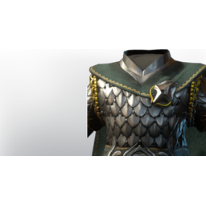

# T4 DPS Chest

| | |
|---|---|
| Category | [Armor & Equipment](../../categories/equipment.md) |
| Rarity | 🔵 Rare |
| Level | 20 |
| Max stack | 1 |
| Item ID | `1567003886` |
| Internal name | `Armor_T4_Warrior_DPS_Chest` |

One of 2 versions of this item: see [T4 DPS Chest](../../objects/equipment/t4-dps-chest.md) for all of them and how they differ.

## Description

This regal soldier armor symbolizes chivalry, glory and valor.

## Stats

| | |
|---|---|
| Slot | Chest |
| Armor | Physical and Magical |
| Health | 240 |
| Stamina | 24 |

## Enhancements

Unlocked one after another as the item is upgraded, in this order. Armor and damage bonuses grow with the item level, so their numbers are shown in game only.

| | Enhancement | Effect |
|:---:|---|---|
| 1 | Cutting Armor | - |
| 2 | Piercing Armor | - |
| 3 | +1 Blood Rage | Increases the skill level of Blood Rage by +1 |
| 4 | Health | +80 Health |
| 5 | +1 Veteran | Increases the skill level of Veteran by +1 |

## How to get it

- **Blacksmith**: 2 × [Monstrous Ribs](../../items/materials/monstrous-ribs-2975006357.md), 6 × [Aloe](../../items/materials/aloe-764289975.md), 2 × [Iron Bars](../../items/materials/iron-bars-159114158.md), 1 × [Padding](../../items/materials/padding-1711247619.md), 1 × [Fell Heart](../../items/materials/fell-heart-536984995.md) → 1 ×

---

[← Armor & Equipment](../../categories/equipment.md) · [All categories](../../README.md)
