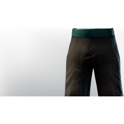

# T4 Healer Legs

| | |
|---|---|
| Category | [Armor & Equipment](../../categories/equipment.md) |
| Rarity | 🔵 Rare |
| Level | 20 |
| Max stack | 1 |
| Item ID | `3183764632` |
| Internal name | `Armor_T4_Mage_Healer_Legs` |

One of 2 versions of this item: see [T4 Healer Legs](../../objects/equipment/t4-healer-legs.md) for all of them and how they differ.

## Description

Remarkable pants. What makes them remarkable? The wearer, mostly.

## Stats

| | |
|---|---|
| Slot | Legs |
| Armor | Physical and Magical |
| Mana | 36 |
| Revive Duration | 0.014 s |

## Enhancements

Unlocked one after another as the item is upgraded, in this order. Armor and damage bonuses grow with the item level, so their numbers are shown in game only.

| | Enhancement | Effect |
|:---:|---|---|
| 1 | Piercing Armor | - |
| 2 | Piercing Armor | - |
| 3 | +1 Healing Revive | Increases the skill level of Healing Revive by +1 |
| 4 | Health | +80 Health |
| 5 | +1 Healing Revive | Increases the skill level of Healing Revive by +1 |

## How to get it

- **Alchemist**: 3 × [Sanddigger Scales](../../items/materials/sanddigger-scales-4079068070.md), 2 × [Monstrous Ribs](../../items/materials/monstrous-ribs-2975006357.md), 1 × [Green Fabric](../../items/materials/green-fabric-2287874170.md), 4 × [Aloe](../../items/materials/aloe-764289975.md), 15 × [Brittle Shroud Flakes](../../items/materials/brittle-shroud-flakes-4091795277.md) → 1 ×

---

[← Armor & Equipment](../../categories/equipment.md) · [All categories](../../README.md)
