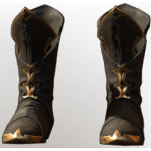

# T4 Ranger Boots

| | |
|---|---|
| Category | [Armor & Equipment](../../categories/equipment.md) |
| Rarity | 🔵 Rare |
| Level | 20 |
| Max stack | 1 |
| Item ID | `2758437730` |
| Internal name | `Armor_T4_Ranger_Archer_DPS_Boots_Loot` |

One of 2 versions of this item: see [T4 Ranger Boots](../../objects/equipment/t4-ranger-boots.md) for all of them and how they differ.

## Description

Stakking prey in these boots makes barely any sound.

## Stats

| | |
|---|---|
| Slot | Feet |
| Armor | Physical and Magical |
| Stamina Regeneration | 12 |
| Stamina Timeout Reduction | -0.35 s |

## Enhancements

Unlocked one after another as the item is upgraded, in this order. Armor and damage bonuses grow with the item level, so their numbers are shown in game only.

| | Enhancement | Effect |
|:---:|---|---|
| 1 | Cutting Armor | - |
| 2 | Piercing Armor | - |
| 3 | +1 Runner | Increases the skill level of Runner by +1 |
| 4 | Enduring | +12 Enduring |
| 5 | +1 Runner | Increases the skill level of Runner by +1 |

---

[← Armor & Equipment](../../categories/equipment.md) · [All categories](../../README.md) · [JSON](t4-ranger-boots-2758437730.json)
