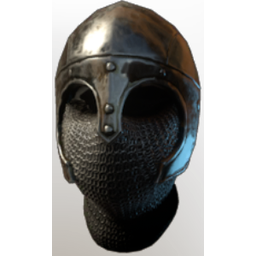

# T4 Rogue Helmet

| | |
|---|---|
| Category | [Armor & Equipment](../../categories/equipment.md) |
| Rarity | 🔵 Rare |
| Level | 20 |
| Max stack | 1 |
| Item ID | `583285715` |
| Internal name | `Armor_T4_Warrior_Rogue_Helmet_Loot` |

One of 2 versions of this item: see [T4 Rogue Helmet](../../objects/equipment/t4-rogue-helmet.md) for all of them and how they differ.

## Description

A sturdy helmet protects the wearer from slashes, cuts and scars.

## Stats

| | |
|---|---|
| Slot | Head |
| Armor | Physical and Magical |
| Merciless Strike Damage | 75 |
| Backstab Damage | 10 |

## Enhancements

Unlocked one after another as the item is upgraded, in this order. Armor and damage bonuses grow with the item level, so their numbers are shown in game only.

| | Enhancement | Effect |
|:---:|---|---|
| 1 | Blunt Armor | - |
| 2 | Piercing Armor | - |
| 3 | +1 Finesse | Increases the skill level of Finesse by +1 |
| 4 | Enduring | +12 Enduring |
| 5 | +1 Thrust | Increases the skill level of Thrust by +1 |

---

[← Armor & Equipment](../../categories/equipment.md) · [All categories](../../README.md) · [JSON](t4-rogue-helmet-583285715.json)
