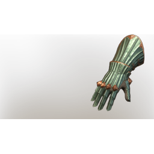

# T4 Skeleton arms

| | |
|---|---|
| Category | [Armor & Equipment](../../categories/equipment.md) |
| Rarity | 🔵 Rare |
| Level | 20 |
| Max stack | 1 |
| Item ID | `1739546422` |
| Internal name | `Armor_T4_MultiClass_SkeletonArmor_Arms` |

## Description

Skeleton armor  arms  desc

## Stats

| | |
|---|---|
| Slot | Hands |
| Armor | Physical and Magical |
| Increases Blunt Damage | 10 |
| Block | 4 |

## Enhancements

Unlocked one after another as the item is upgraded, in this order. Armor and damage bonuses grow with the item level, so their numbers are shown in game only.

| | Enhancement | Effect |
|:---:|---|---|
| 1 | Ice Armor | - |
| 2 | Cutting Armor | - |
| 3 | +1 Bone to Ash | Increases the skill level of Bone to Ash by +1 |
| 4 | +1 Bone to Ash | Increases the skill level of Bone to Ash by +1 |
| 5 | All Physical Blunt Damage | +5 All Physical Blunt Damage |

---

[← Armor & Equipment](../../categories/equipment.md) · [All categories](../../README.md) · [JSON](t4-skeleton-arms-1739546422.json)
