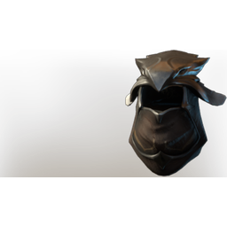

# T4 Sniper Helmet

| | |
|---|---|
| Category | [Armor & Equipment](../../categories/equipment.md) |
| Rarity | 🔵 Rare |
| Level | 20 |
| Max stack | 1 |
| Item ID | `3687213212` |
| Internal name | `Armor_T4_Ranger_Sniper_Helmet_Loot` |

One of 2 versions of this item: see [T4 Sniper Helmet](../../objects/equipment/t4-sniper-helmet.md) for all of them and how they differ.

## Description

This archery hood allows you to focus solely on your target.

## Stats

| | |
|---|---|
| Slot | Head |
| Armor | Physical and Magical |
| Critical Strike Chance Ranged | 6 |
| Skillshot Damage | 19 |

## Enhancements

Unlocked one after another as the item is upgraded, in this order. Armor and damage bonuses grow with the item level, so their numbers are shown in game only.

| | Enhancement | Effect |
|:---:|---|---|
| 1 | Piercing Armor | - |
| 2 | Cutting Armor | - |
| 3 | +1 Sniper | Increases the skill level of Sniper by +1 |
| 4 | Enduring | +12 Enduring |
| 5 | +1 Sniper | Increases the skill level of Sniper by +1 |

---

[← Armor & Equipment](../../categories/equipment.md) · [All categories](../../README.md)
