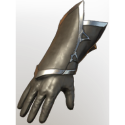

# T4 Wizard Arms

| | |
|---|---|
| Category | [Armor & Equipment](../../categories/equipment.md) |
| Rarity | 🔵 Rare |
| Level | 20 |
| Max stack | 1 |
| Item ID | `1559651833` |
| Internal name | `Armor_T4_Mage_BattleSword_Arms_Loot` |

## Description

With these gloves, all the magic of the world can easily flow through you and into the tips of your fingers.

## Stats

| | |
|---|---|
| Slot | Hands |
| Armor | Physical and Magical |
| One-Handed Melee | 12 |
| Block | 2 |

## Enhancements

Unlocked one after another as the item is upgraded, in this order. Armor and damage bonuses grow with the item level, so their numbers are shown in game only.

| | Enhancement | Effect |
|:---:|---|---|
| 1 | Blunt Armor | - |
| 2 | Cutting Armor | - |
| 3 | +1 Slasher | Increases the skill level of Slasher by +1 |
| 4 | Spiritual | +16 Spiritual |
| 5 | +1 Arsonist | Increases the skill level of Arsonist by +1 |

---

[← Armor & Equipment](../../categories/equipment.md) · [All categories](../../README.md) · [JSON](t4-wizard-arms-1559651833.json)
