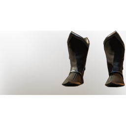

# T4 Wizard Boots

| | |
|---|---|
| Category | [Armor & Equipment](../../categories/equipment.md) |
| Rarity | 🔵 Rare |
| Level | 20 |
| Max stack | 1 |
| Item ID | `3167272673` |
| Internal name | `Armor_T4_Mage_BattleSword_Boots_Loot` |

## Description

Ground yourself, feel the earth beaneath your feet. Connect to the magical core of the world.

## Stats

| | |
|---|---|
| Slot | Feet |
| Armor | Physical and Magical |
| Health Regeneration | 12 |
| Stamina Regeneration | 6 |

## Enhancements

Unlocked one after another as the item is upgraded, in this order. Armor and damage bonuses grow with the item level, so their numbers are shown in game only.

| | Enhancement | Effect |
|:---:|---|---|
| 1 | Cutting Armor | - |
| 2 | Blunt Armor | - |
| 3 | +1 Frost | Increases the skill level of Frost by +1 |
| 4 | Vital | +12 Vital |
| 5 | +1 Warrior's Path | Increases the skill level of Warrior's Path by +1 |

---

[← Armor & Equipment](../../categories/equipment.md) · [All categories](../../README.md)
