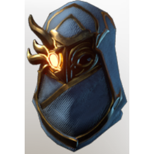

# T4b Archer Helmet

| | |
|---|---|
| Category | [Armor & Equipment](../../categories/equipment.md) |
| Rarity | 🔵 Rare |
| Level | 30-55 |
| Max stack | 1 |
| Item ID | `382265240` |
| Internal name | `Armor_T5-TX_Ranger_Archer_DPS_Helmet_Loot` |

## Description

This hood further enhances your sight and lets your gaze burn hotter than a thousand suns.

## Stats

| | |
|---|---|
| Slot | Head |
| Armor | Physical and Magical |
| Critical Strike Chance Ranged | 12 |
| Critical Strike Damage | 14 |
| Cold Resistance | 2 |
| Wet Duration Reduction | 2:00 min |

## Enhancements

Unlocked one after another as the item is upgraded, in this order. Armor and damage bonuses grow with the item level, so their numbers are shown in game only.

| | Enhancement | Effect |
|:---:|---|---|
| 1 | Piercing Armor | - |
| 2 | Enduring | +15 Enduring |
| 3 | +1 Puncture | Increases the skill level of Puncture by +1 |
| 4 | Ice Armor | - |
| 5 | +1 Fatal Precision | Increases the skill level of Fatal Precision by +1 |

---

[← Armor & Equipment](../../categories/equipment.md) · [All categories](../../README.md)
