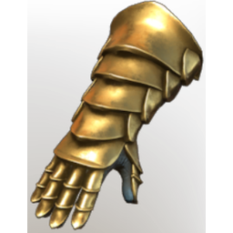

# T4b Warrior Arms

| | |
|---|---|
| Category | [Armor & Equipment](../../categories/equipment.md) |
| Rarity | ⚪ Common |
| Level | 30-55 |
| Max stack | 1 |
| Item ID | `473258476` |
| Internal name | `Armor_T5-TX_Warrior_DPS_Arms_Loot` |

## Description

These gloves are radiate warmth and safety as if steeped in pure liquid light.

## Stats

| | |
|---|---|
| Slot | Hands |
| Armor | Physical and Magical |
| Two-Handed Melee | 15 |
| Damage against Melee Foes | 4 |
| Cold Resistance | 1 |
| Wet Duration Reduction | 1:30 min |

## Enhancements

Unlocked one after another as the item is upgraded, in this order. Armor and damage bonuses grow with the item level, so their numbers are shown in game only.

| | Enhancement | Effect |
|:---:|---|---|
| 1 | Fog Armor | - |
| 2 | Health | +100 Health |
| 3 | +1 Heavy Handed | Increases the skill level of Heavy Handed by +1 |
| 4 | Shock Armor | - |
| 5 | +1 Slasher | Increases the skill level of Slasher by +1 |

---

[← Armor & Equipment](../../categories/equipment.md) · [All categories](../../README.md)
