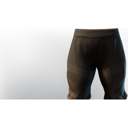

# T6 Assassin Legs

| | |
|---|---|
| Category | [Armor & Equipment](../../categories/equipment.md) |
| Rarity | 🔵 Rare |
| Level | 40 |
| Max stack | 1 |
| Item ID | `2230173783` |
| Internal name | `Armor_T6_Ranger_Assassin_Legs` |

One of 2 versions of this item: see [T6 Assassin Legs](../../objects/equipment/t6-assassin-legs.md) for all of them and how they differ.

## Description

t6 assassin legs desc

## Stats

| | |
|---|---|
| Slot | Legs |
| Armor | Physical and Magical |
| Mana | 54 |
| Sneak  Speed | 30 |
| Wet Duration Reduction | 2:00 min |

## Enhancements

Unlocked one after another as the item is upgraded, in this order. Armor and damage bonuses grow with the item level, so their numbers are shown in game only.

| | Enhancement | Effect |
|:---:|---|---|
| 1 | Blunt Armor | - |
| 2 | Blunt Armor | - |
| 3 | +1 Cutthroat | Increases the skill level of Cutthroat by +1 |
| 4 | Stamina | +24 Stamina |
| 5 | +1 Veiled Vigor | Increases the skill level of Veiled Vigor |

## How to get it

- **Hunter**: 4 × [Green Vitriol Dust](../../items/materials/green-vitriol-dust-3702590848.md), 3 × [Water Reptile Leather](../../items/materials/water-reptile-leather-2059656108.md), 4 × [Capybara Bristles](../../items/materials/capybara-bristles-4230368891.md), 50 × Placeholder: Pink Mushroom Meat, 1 × Placeholder: Greater Fell Heart → 1 ×

---

[← Armor & Equipment](../../categories/equipment.md) · [All categories](../../README.md) · [JSON](t6-assassin-legs-2230173783.json)
