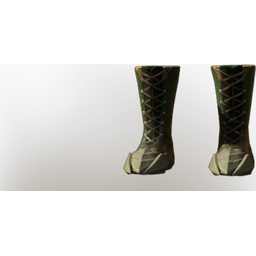

# T6 Drak Boots - Unique

| | |
|---|---|
| Category | [Armor & Equipment](../../categories/equipment.md) |
| Rarity | 🟠 Legendary |
| Level | 40 |
| Max stack | 1 |
| Item ID | `480197774` |
| Internal name | `Armor_T6_Unique_Drak_Boots` |

## Description

t6 Drak boots desc - unique

## Stats

| | |
|---|---|
| Slot | Feet |
| Armor | Physical and Magical |
| Stamina Regeneration | 12 |
| Stamina Timeout Reduction | -0.25 s |
| Damage against Drak | 5 |
| Wet Duration Reduction | 1:30 min |

## Enhancements

Unlocked one after another as the item is upgraded, in this order. Armor and damage bonuses grow with the item level, so their numbers are shown in game only.

| | Enhancement | Effect |
|:---:|---|---|
| 1 | Cutting Armor | - |
| 2 | Stamina | +24 Stamina |
| 3 | Piercing Armor | - |
| 4 | Stalking | +10 Damage against Wildlife and Wildbeasts |
| 5 | Ophidian | +10 Damage against Drak |

---

[← Armor & Equipment](../../categories/equipment.md) · [All categories](../../README.md)
